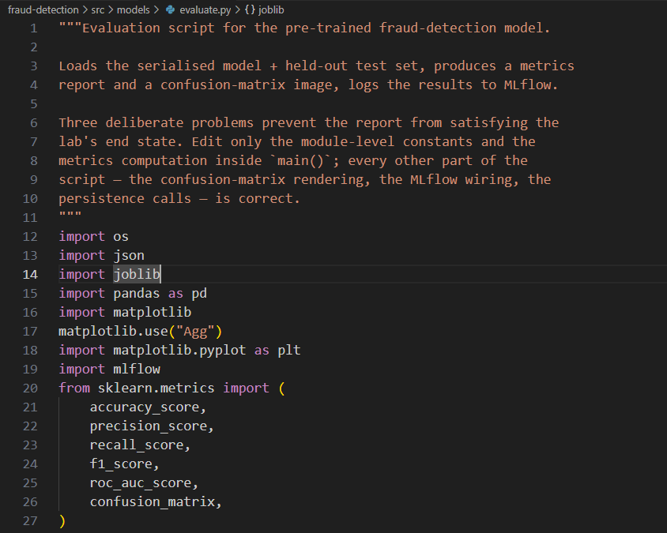
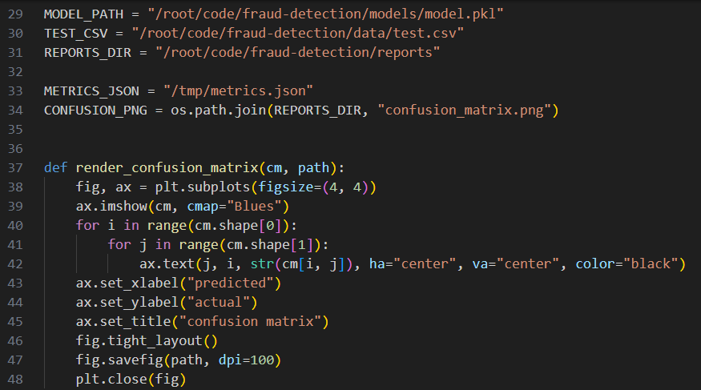
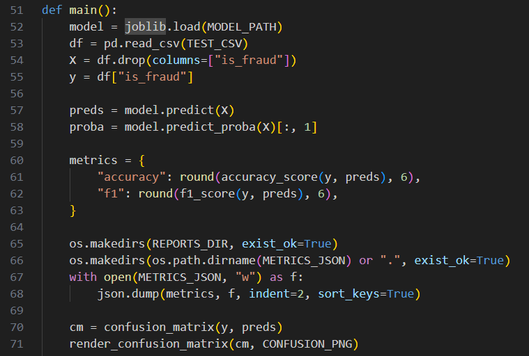
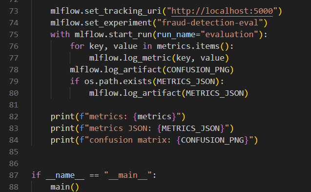
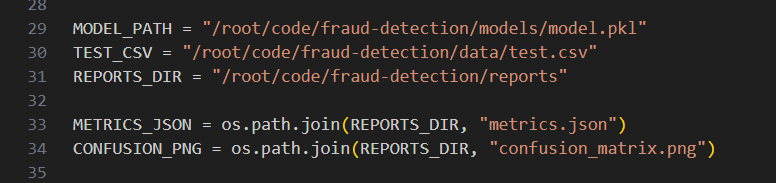
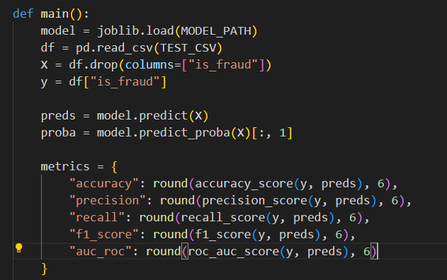
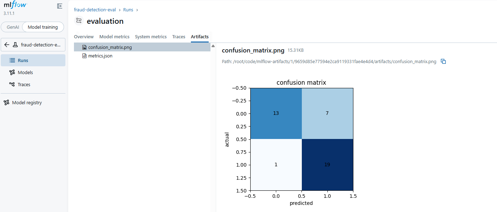
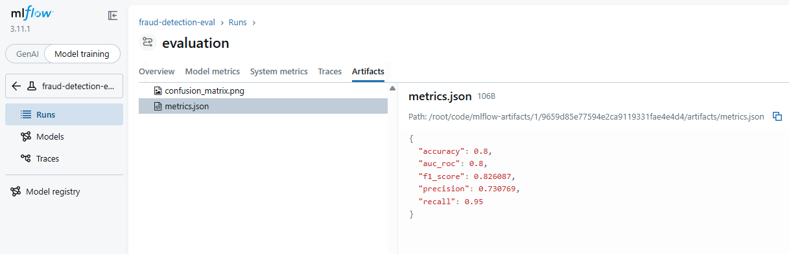
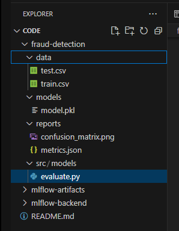

# Day 33:  Evaluate a Trained Model and Generate Classification Report

**subject**

***

The xFusionCorp Industries ML platform team's release checklist requires a five-metric evaluation report for every candidate model, plus a confusion-matrix image, published to the project's reports/ directory. A draft evaluate.py exists for the pre-trained fraud-detection model, but the report it produces does not satisfy the checklist. Your task is to correct the evaluator so the expected report lands in the right place.

1. The MLflow tracking server is already running on port 5000. The MLflow UI button at the top of the lab can be opened to confirm—the dashboard loads with an empty fraud-detection-eval experiment.
2. The project layout under /root/code/fraud-detection/ :
   * data/test.csv - 40-row held-out test set from an 80/20 stratified split.
   * models/model.pkl - A deterministic RandomForestClassifier pre-trained at lab startup. Do not retrain it.
   * src/models/evaluate.py - The evaluator draft (has bugs). Every concern other than the metrics report is correctly wired: the confusion-matrix rendering, the MLflow run, the artefact logging.
   * reports/ - Where the metrics JSON and confusion-matrix image must land.
3. Open src/models/evaluate.py in the VS Code editor, correct everything that prevents the end state below from being reached, save, and run the script.
4. The end state must include:
   * A file at /root/code/fraud-detection/reports/metrics.json (absolute path, inside the project's reports directory).
   * That JSON contains exactly these five keys, each a numeric value: accuracy, precision, recall, f1\_score, auc\_roc.
   * A file at /root/code/fraud-detection/reports/confusion\_matrix.png .
   * One MLflow run in the fraud-detection-eval experiment with the five metrics logged and both files attached as run artefacts.

The model file and test set are correct and must not be modified—the fix is confined to evaluate.py .

***

* Check the file with error

* Fix evalute.py

Fix the metrics.json file

Add more metrics in metrics dict

* Check result

