# Day 36: Automated Model Selection with FLAML AutoML

**subject**

***

The xFusionCorp Industries ML platform team is running a three-way bake-off between a RandomForest, a GradientBoosting, and a LogisticRegression candidate for fraud detection, with every candidate tracked as an MLflow run in the`bakeoff`experiment. Three correct trainer scripts are already in place, but the orchestrator at`/root/code/fraud-detection/src/models/bakeoff.py`picks the wrong winner and writes an incomplete report. Your task is to correct the orchestrator so the saved winner is the highest-F1 candidate and the report identifies which model family won.

1. The MLflow tracking server is already running on port`5000`. The**MLflow UI**button at the top of the lab can be opened to confirm—the dashboard loads with an empty`bakeoff`experiment.
2. The project layout under`/root/code/fraud-detection/`:
   * `data/train.csv`– The same 200-row synthetic binary-classification dataset Day 34 uses (imbalanced roughly 70 / 30).
   * `src/models/train_rf.py`,`src/models/train_gb.py`,`src/models/train_lr.py`– Three independent trainer scripts. Each one fits its named estimator with 3-fold stratified CV and logs one MLflow run tagged`candidate=<model family>`with the mean`f1_score`metric and its hyperparameters. These three files are correct and need no edits.
   * `src/models/bakeoff.py`– The orchestrator. It queries the`bakeoff`experiment with`mlflow.search_runs(...)`and writes`/root/code/fraud-detection/reports/winner.json`. Two specific corrections are required.
3. Run each of the three trainer scripts once so every candidate is logged, open`src/models/bakeoff.py`in the VS Code editor, correct the two problems that keep the report from meeting the release checklist, save, and run the orchestrator.
4. The end state must include:
   * Three runs exist in the`bakeoff`MLflow experiment, one per candidate, each with`tags.candidate`, the candidate's hyperparameters, and`metrics.f1_score`.
   * A JSON file at`/root/code/fraud-detection/reports/winner.json`with exactly three keys:`model_type`(one of`random_forest`,`gradient_boosting`,`logistic_regression`),`run_id`, and`f1_score`.
   * The`model_type`,`run_id`, and`f1_score`stored in`winner.json`correspond to the candidate with the highest`f1_score`in the`bakeoff`experiment.

> The MLflow Compare view—select all three runs in the experiment's run list and click**Compare**—is the fastest way to eyeball which candidate won and spot-check the report.

***

https://medium.com/@mouse3mic3/a-practical-guide-to-automated-machine-learning-in-python-using-flaml-c73a714887a4

* Check each model code

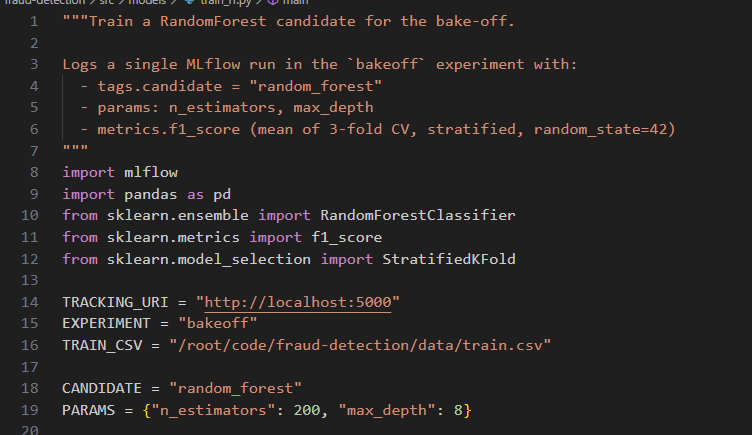

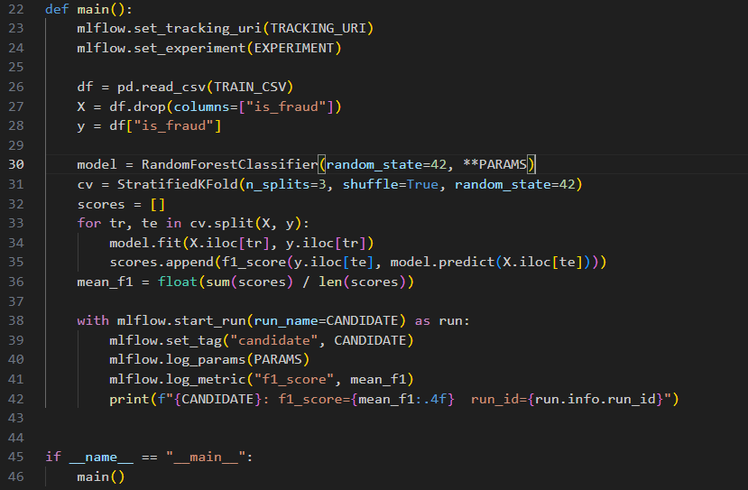

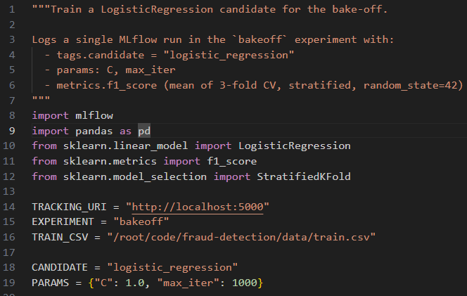

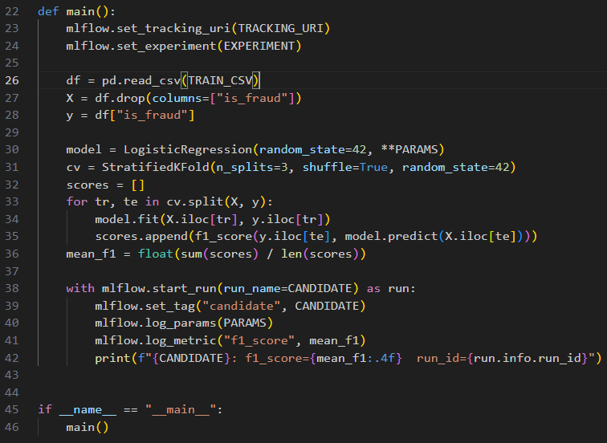

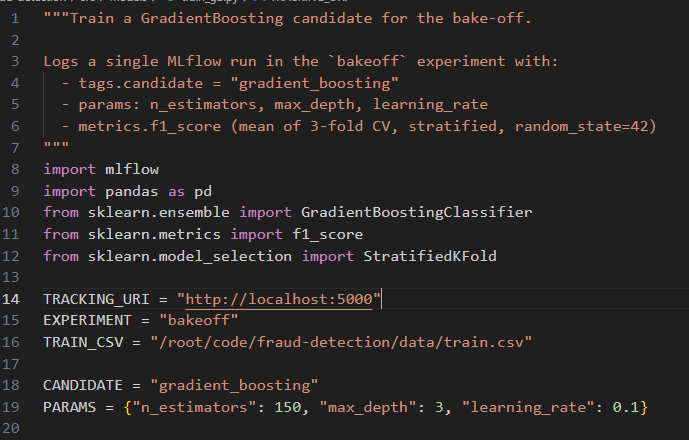

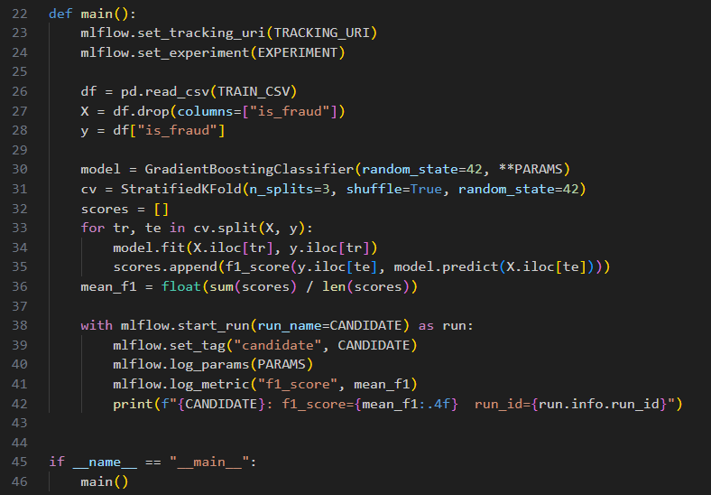

* Check the bakeoff code

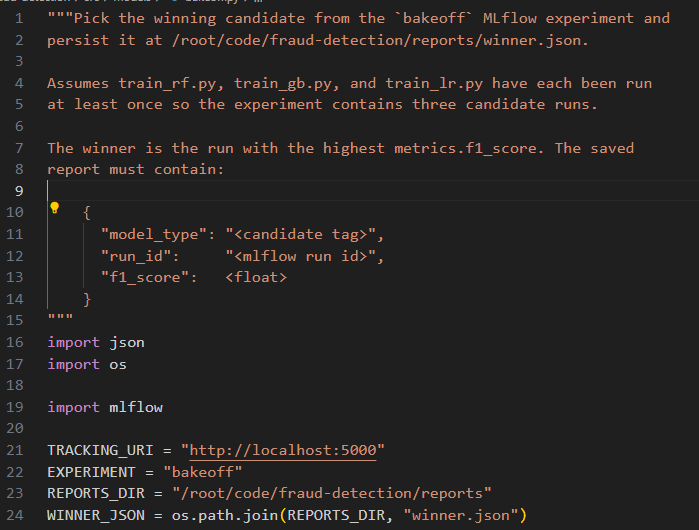

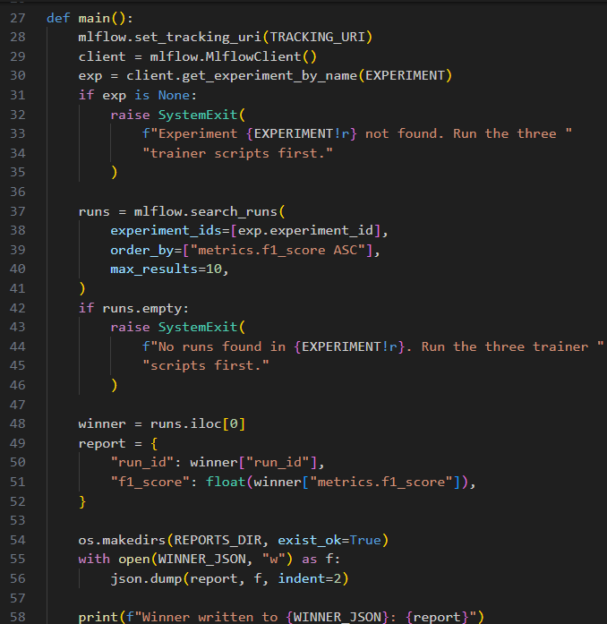

* Fix the error

fix the winner selection 

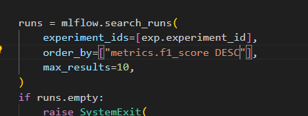

add the model name

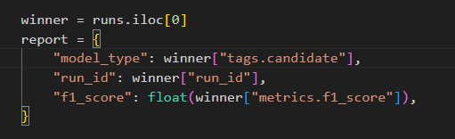

* Run and check

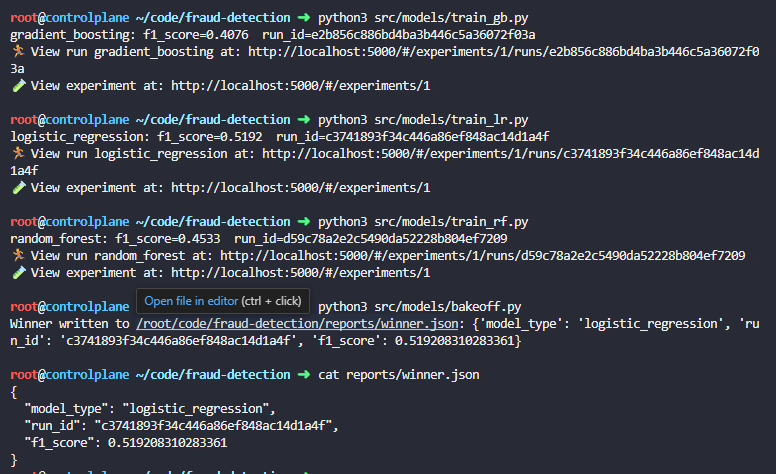

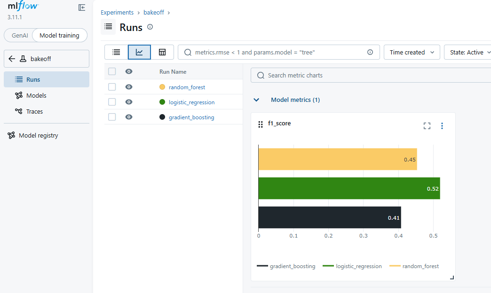

