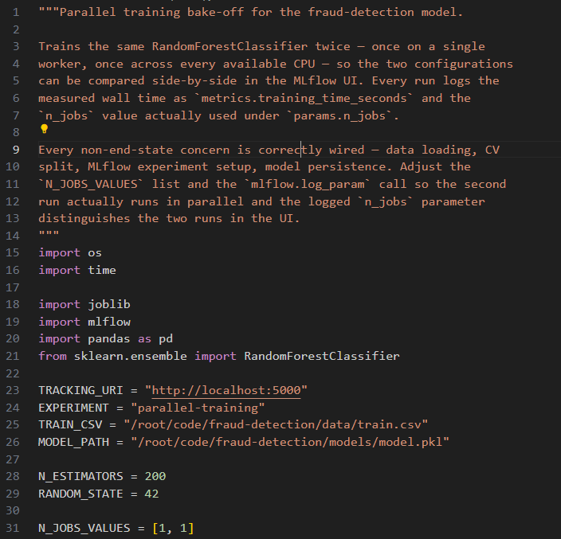
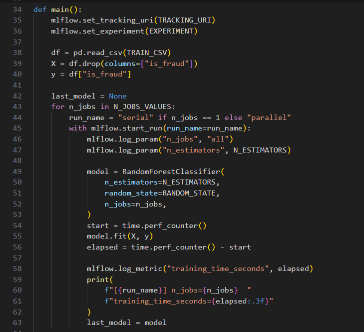
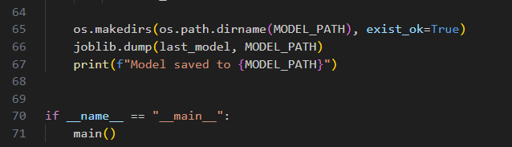
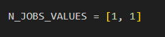
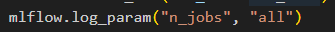
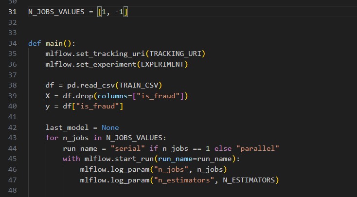
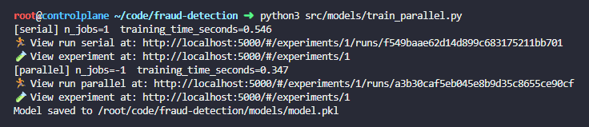
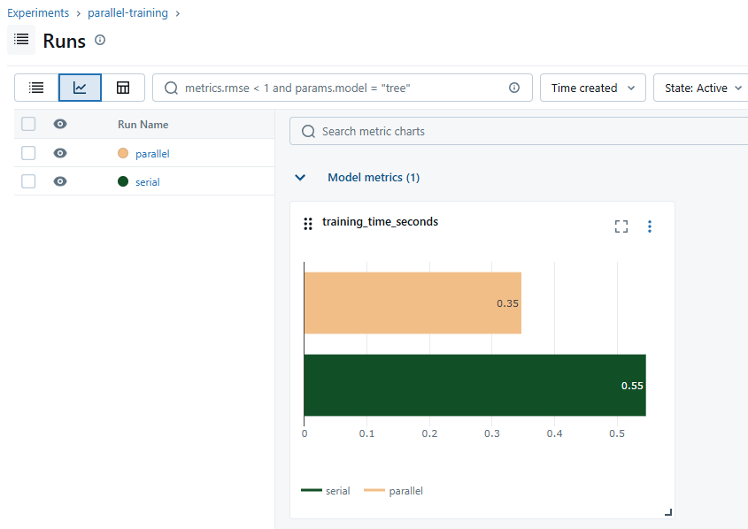

# Day 38: Build Modular Training Pipeline with Config-Driven Stages

**subject**

***

The xFusionCorp Industries ML platform team runs a parallel-training bake-off on the fraud-detection model—the same estimator is trained twice, once on a single worker and once across every available CPU, and the MLflow Compare view surfaces the wall-time gap. A draft script exists at`/root/code/fraud-detection/src/models/train_parallel.py`, but running it currently produces near-identical wall times for the 'serial' and 'parallel' runs, and the Compare view cannot distinguish the two configurations. Your task is to correct the script so the second run genuinely runs in parallel and every MLflow run records the number of workers it actually used.

1. The MLflow tracking server is already running on port`5000`. The**MLflow UI**button at the top of the lab can be opened to confirm—the dashboard loads with an empty`parallel-training`experiment.
2. The project layout under`/root/code/fraud-detection/`:
   * `data/train.csv`– A 5000-row synthetic binary-classification dataset (imbalanced roughly 70 / 30). Larger than the 200-row dataset used earlier in the section because the`n_jobs`speedup is only visible once there is enough work per tree.
   * `src/models/train_parallel.py`– The bake-off script. Data loading, MLflow experiment setup, wall-time measurement,`metrics.training_time_seconds`logging, and model persistence to`models/model.pkl`are already wired; corrections are required.
3. Open`src/models/train_parallel.py`in the VS Code editor, correct every issue that keeps the bake-off from meeting the release checklist, save, and run the script once.
4. The end state must include:
   * At least two runs exist in the`parallel-training`experiment on MLflow. Across the two runs,`params.n_jobs`takes the values`1`and`-1`(no run still carries the hardcoded`"all"`).
   * Every run carries`metrics.training_time_seconds`, and the`n_jobs = -1`run is measurably faster than the`n_jobs = 1`run (at least 10 %).
   * A pickled model at`/root/code/fraud-detection/models/model.pkl`.

***

* Check the current work

* Check the error

* Apply the fix

* Run and check

