# Day 40: Production Training System: Tracking, Tuning, and Model Selection

**subject**

***

The xFusionCorp Industries ML platform team ships a full fraud-detection training pipeline—data validation, Optuna tuning across two model families, model selection against a release threshold, Model Registry registration with a release-lane alias, and a consolidated training report—all wired together behind a single`make train-pipeline`command. The pre-staged system does not currently run end-to-end: each`make train-pipeline`invocation surfaces a wiring issue, and the integration across the`Makefile`,`src/select_model.py`, and`src/register.py`needs attention before the release checklist passes. Your task is to correct the wiring so`make train-pipeline`runs cleanly end-to-end, the MLflow Model Registry holds a`fraud-detector`version under the`staging`alias, and`reports/training_report.json`aggregates every upstream artefact.

1. The MLflow tracking server is already running on port`5000`. The**MLflow UI**button at the top of the lab can be opened to confirm—the dashboard loads with an empty`fraud-detection-tuning`experiment.
2. The project layout under`/root/code/fraud-detection/`:
   * `data/train.csv`– The 200-row synthetic binary-classification dataset the rest of the Training section uses.
   * `src/validate_data.py`– Schema + null-check gate. Writes`reports/validation_status.json`. Correct.
   * `src/tune.py`– Runs 10 Optuna trials across RandomForest and GradientBoosting, each logged as an MLflow run tagged with`model_type`+`params.{n_estimators,max_depth}`+`metrics.f1_score`+ the fitted model artefact. Correct.
   * `src/select_model.py`– Picks the winning run by the training metric and writes`reports/selection.json`. Needs attention.
   * `src/register.py`– Registers the selected run's model as`fraud-detector`and assigns the release-lane alias. Needs attention.
   * `src/report.py`– Aggregates every upstream artefact into`reports/training_report.json`. Correct.
   * `Makefile`–`train-pipeline`target runs the five stages in order. Needs attention.
3. Run`make train-pipeline`from`/root/code/fraud-detection/`to surface each issue in turn. Open the offending file in the VS Code editor, correct the wiring, and re-run until the pipeline completes without non-zero exit.
4. The end state must include:
   * `make train-pipeline`completes without non-zero exit.
   * The`fraud-detection-tuning`MLflow experiment carries at least five trial runs, each with`metrics.f1_score`.
   * `reports/selection.json`,`reports/validation_status.json`, and`reports/training_report.json`are all present. The training report carries`best_model`,`best_params`,`metrics`,`total_trials`, and`validation_status`keys;`validation_status`is`"ok"`and`total_trials`is an integer ≥ 5.
   * The MLflow Model Registry (**MLflow UI**→**Models**) shows a`fraud-detector`registered model with at least one version. That version carries the`staging`alias and no`production`alias.

> Run`make train-pipeline`once against the scaffold as-is; the first wiring issue surfaces immediately. Each subsequent re-run reveals the next stage's problem. Every fix is a one-line edit in one of the three files listed above.

***

* Check the current work

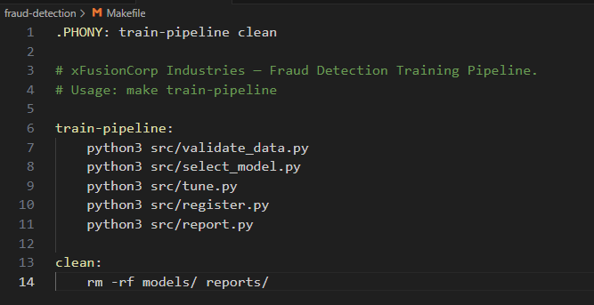

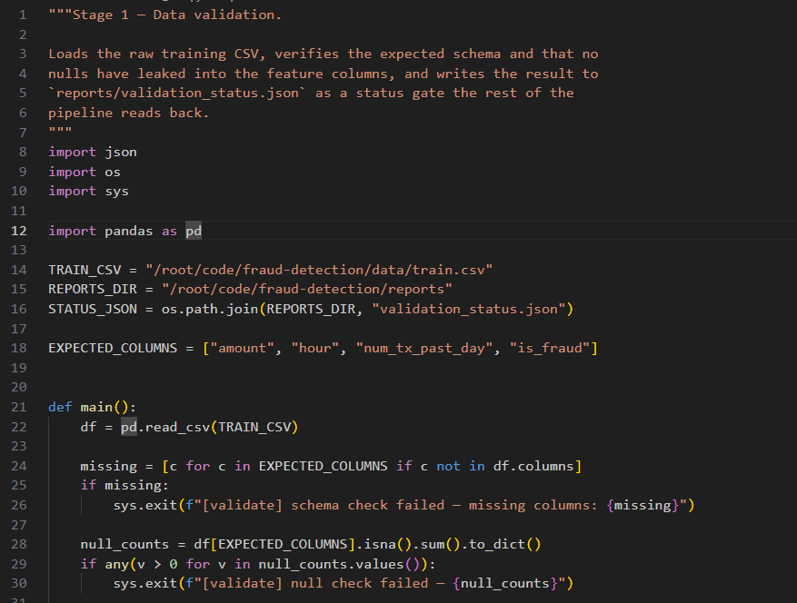

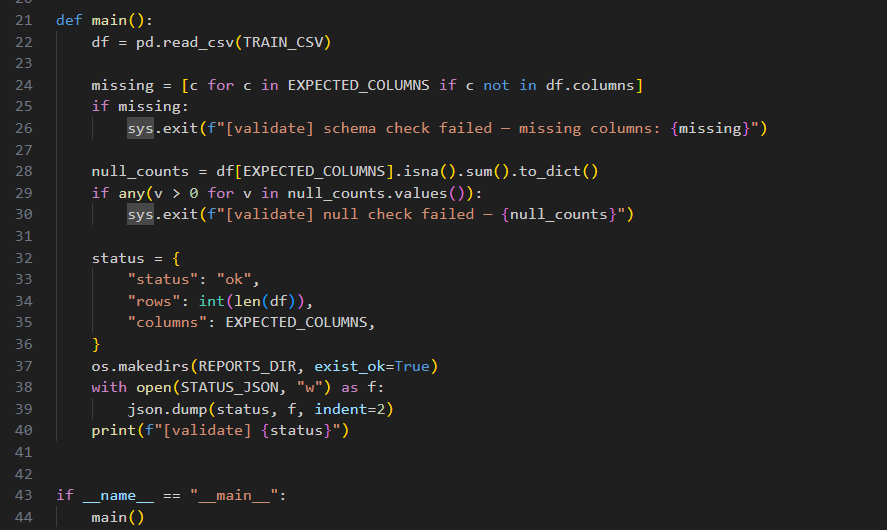

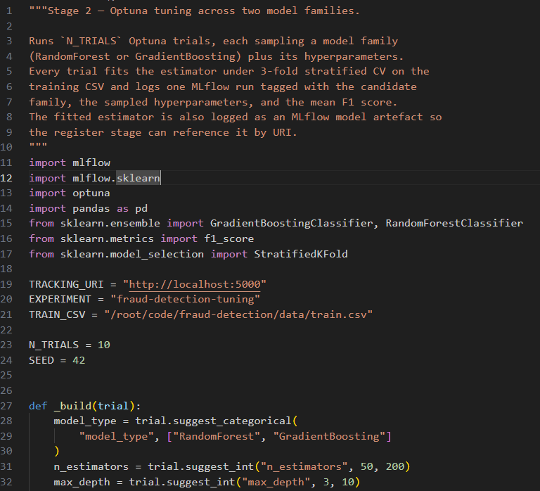

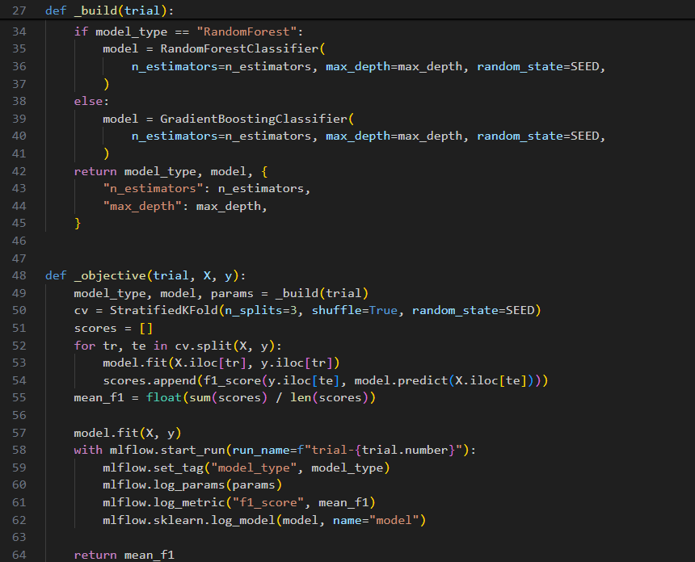

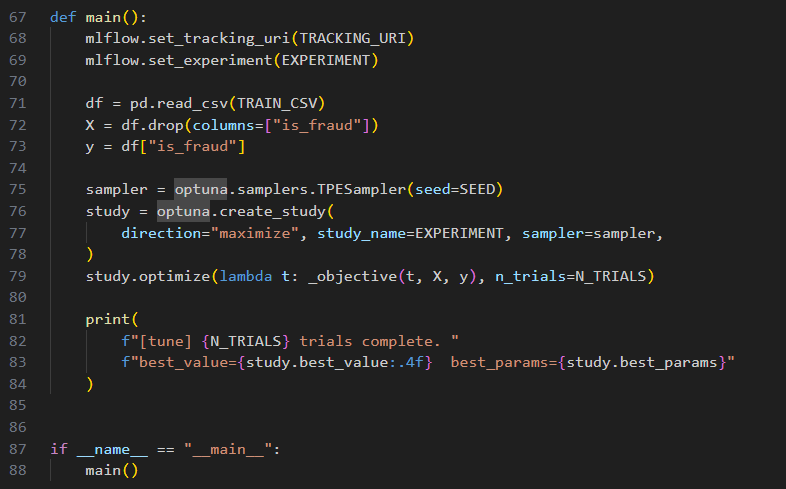

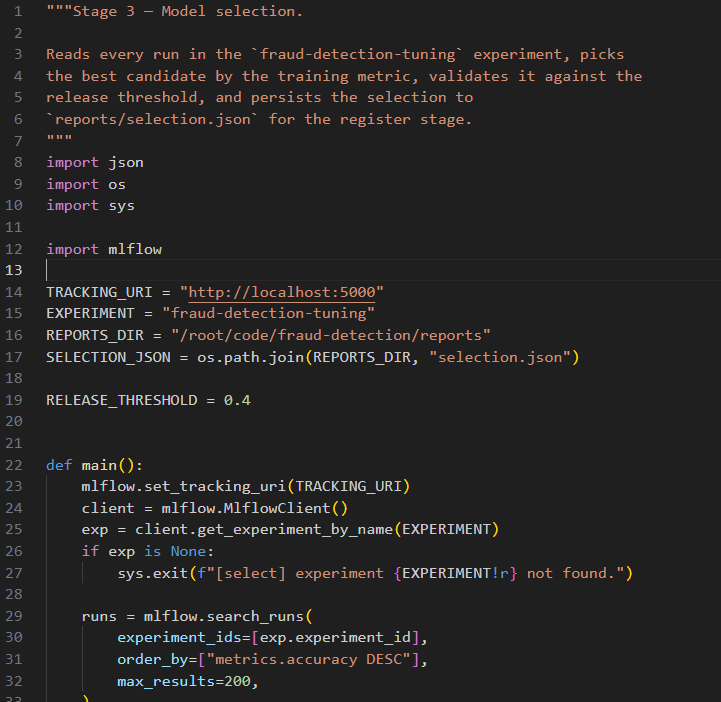

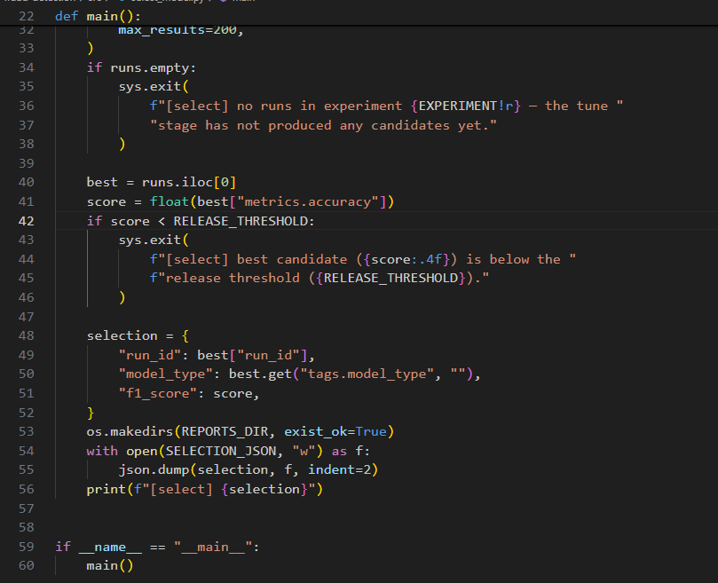

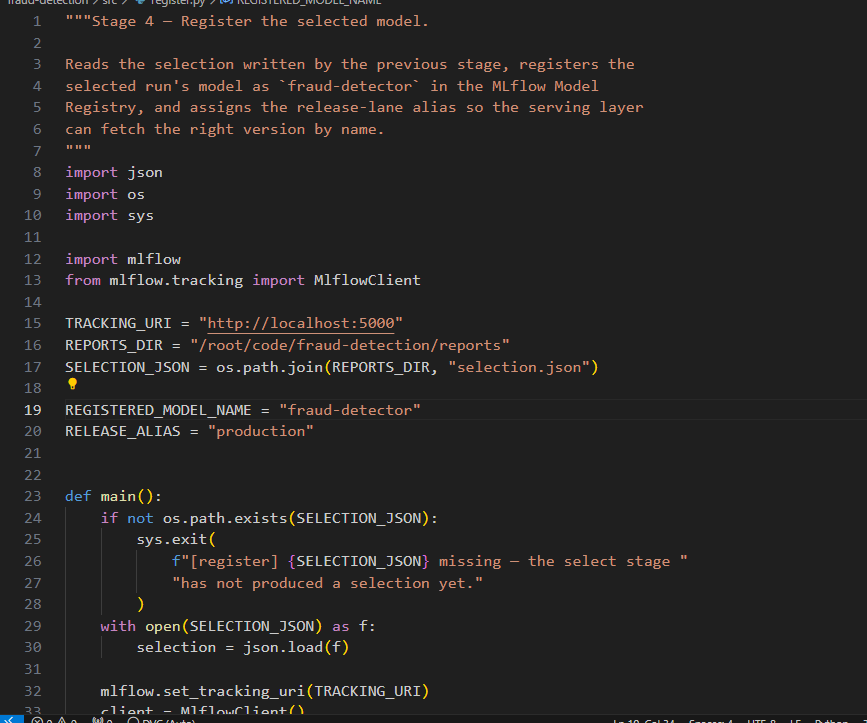

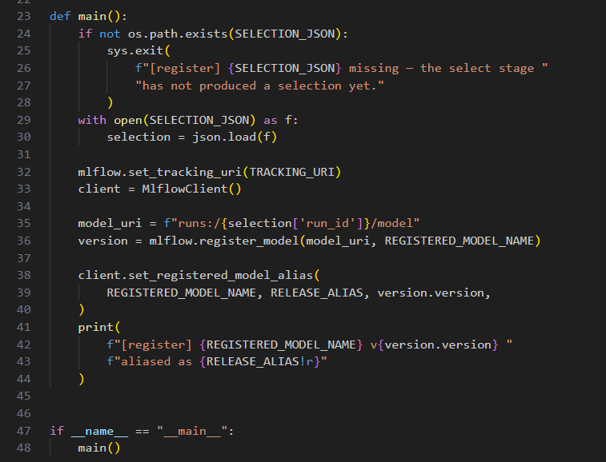

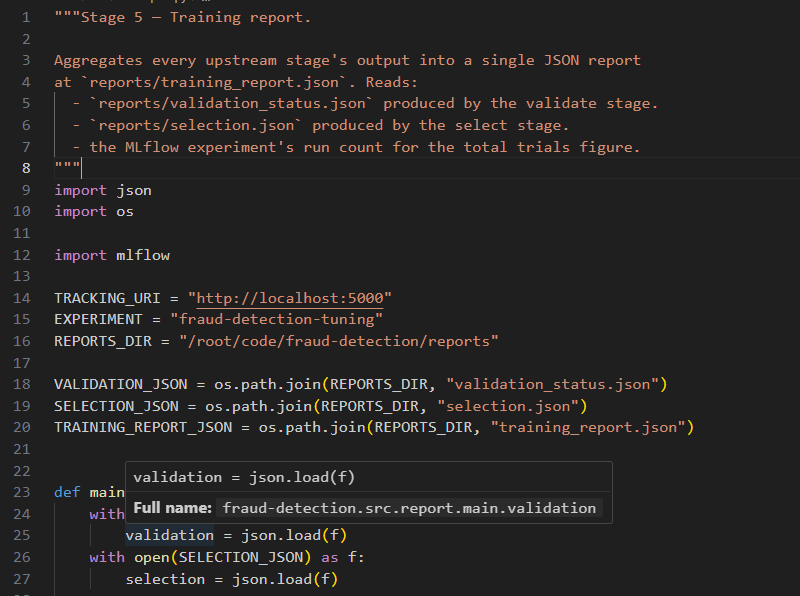

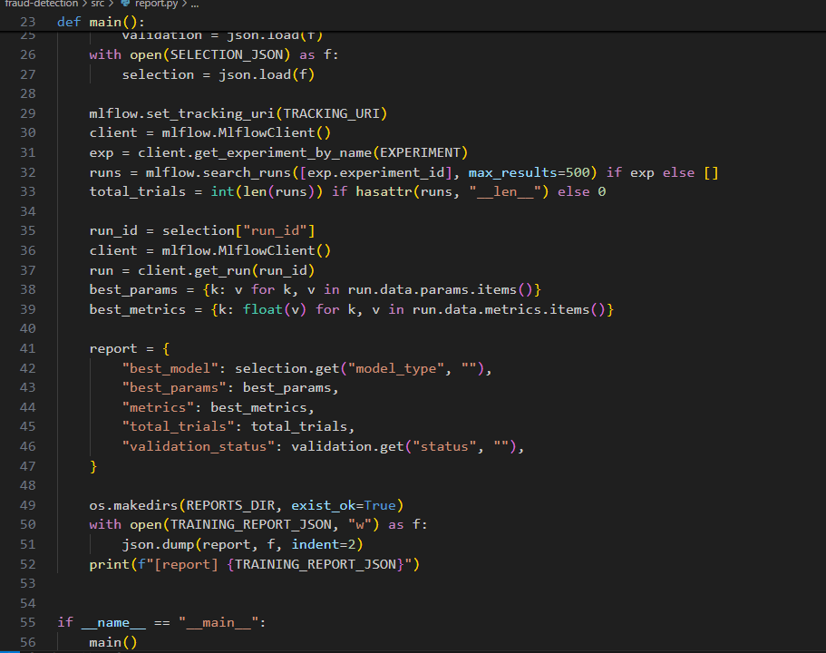

* Check errors

in select\_model.py replace accuray to f1\_score

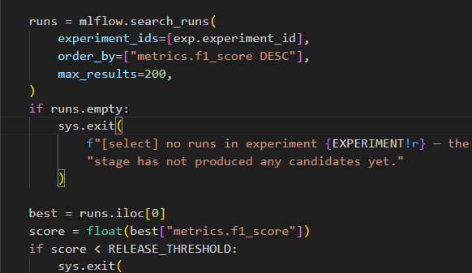

in the makefile, fix order

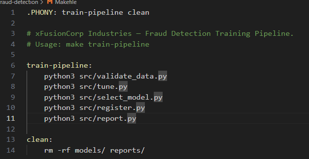

fix the alias in register.py

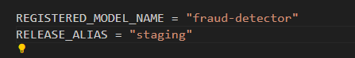

* Run and check

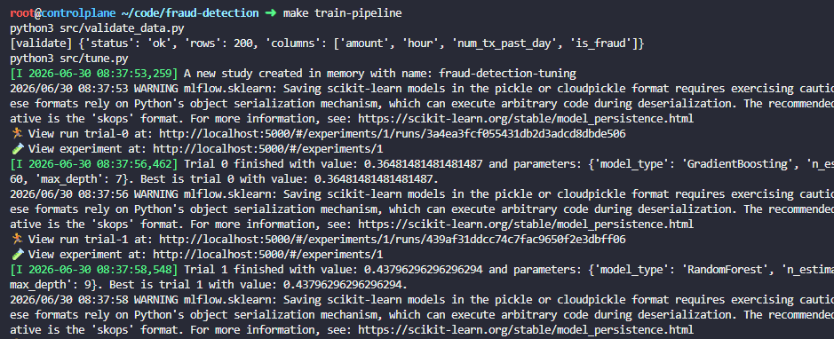

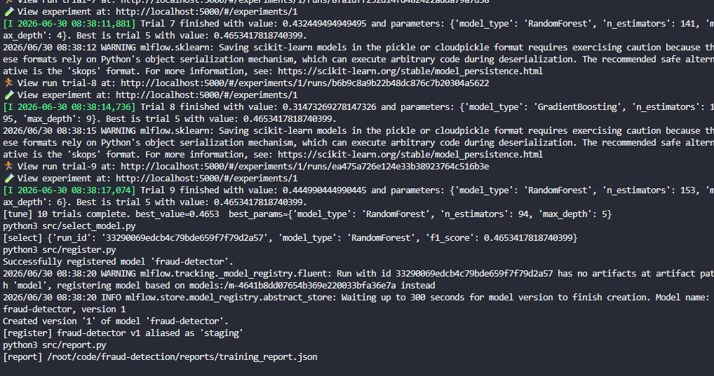

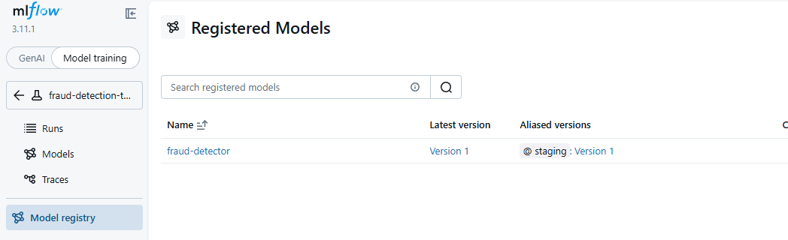
