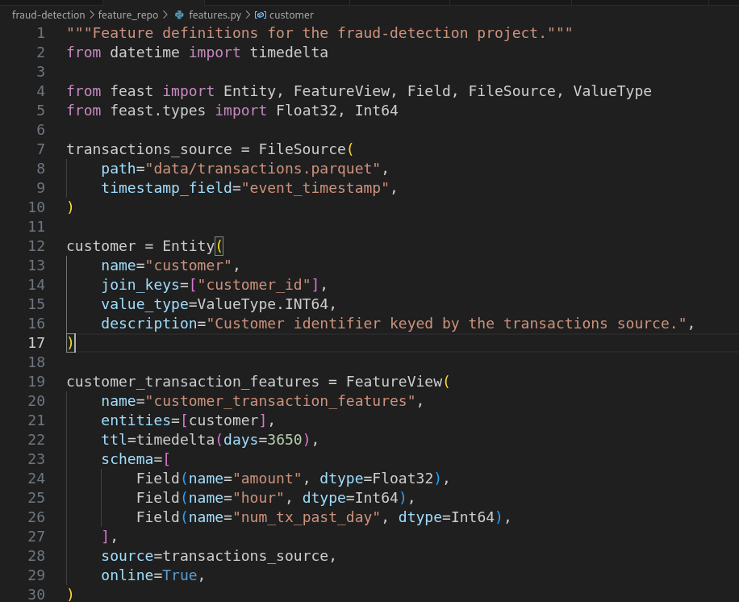
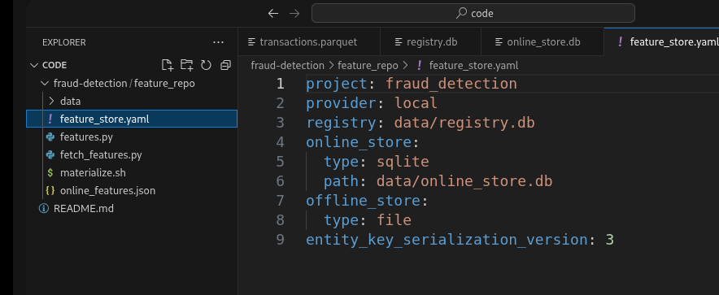
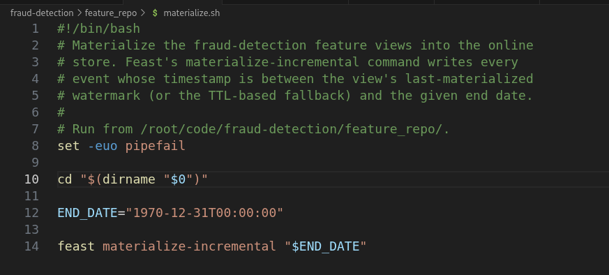
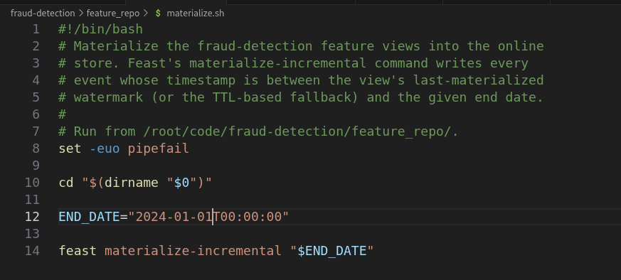
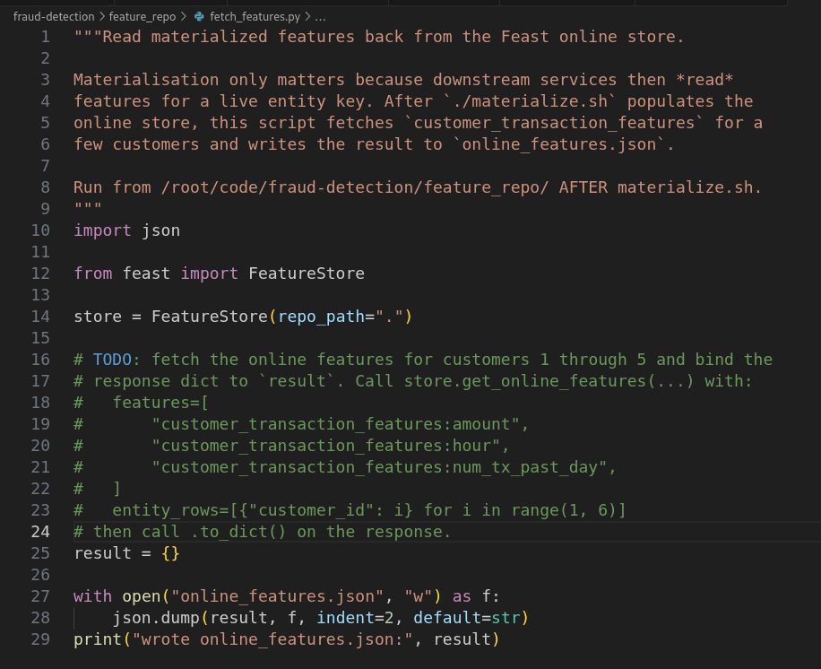
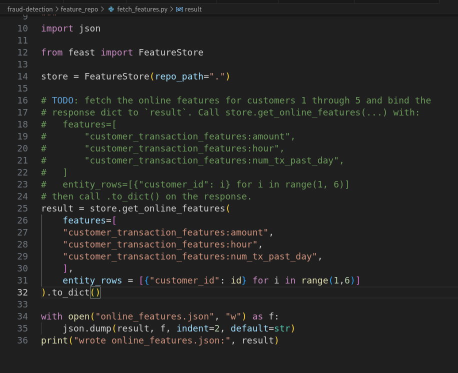

# Day 43: Materialize Features and Read Them from the Online Store

**subject**

***

The xFusionCorp Industries ML platform team stages a materialisation script (`materialize.sh`) under`/root/code/fraud-detection/feature_repo/`so the batch job that populates the Feast online store is always repeatable. The registry has already been applied against a correct`features.py`, but running the script writes zero rows into the online sqlite store. Your task is to correct`materialize.sh`so`./materialize.sh`populates the online store, then author`fetch_features.py`to read the features back via`store.get_online_features()`and confirm a non-null`amount`for a known customer.

1. The Feast UI is already running on port`8888`. The**Feast UI**button at the top of the lab can be opened to confirm—the dashboard loads the`fraud_detection`project, the`customer`entity, and the`customer_transaction_features`feature view. Materialisation status is not visible in the UI; the online store is inspected from the terminal.
2. The repository layout under`/root/code/fraud-detection/feature_repo/`:
   * `feature_store.yaml`– Local provider, sqlite online store at`data/online_store.db`. Correct.
   * `features.py`– Declares the`customer`entity (`join_keys=["customer_id"]`) and the`customer_transaction_features`view over the transactions source. Correct.
   * `data/transactions.parquet`– 200-row synthetic source, event timestamps from`2024-01-01`onward.
   * `data/registry.db`– Already written by`feast apply`at startup.
   * `materialize.sh`– Single-purpose shell script that calls`feast materialize-incremental "$END_DATE"`.
   * `fetch_features.py`– Reads features back from the online store; the`store.get_online_features(...)`call is left as a`# TODO`.
3. The end state must include:
   * `materialize.sh`'s end date is an ISO-8601 date on or after`2024-01-01`, and`data/online_store.db`is populated (on-disk size comfortably larger than the bare sqlite header, ≥ 4 KB).
   * `fetch_features.py`calls`store.get_online_features(features=["customer_transaction_features:amount", …], entity_rows=[{"customer_id": i}, …])`and writes`online_features.json`.
   * `online_features.json`carries at least one non-null`amount`value for a customer id present in the source.

> `feast materialize-incremental`takes a single ISO-8601 end date and uses the feature view's TTL to pick the start watermark on the first run. Run`./materialize.sh`and read its output — the summary line reports how many rows were written into the online store, which is where the zero shows up.

***

https://docs.feast.dev/getting-started/quickstart#feature\_store.yaml

https://docs.feast.dev/how-to-guides/feast-snowflake-gcp-aws/load-data-into-the-online-store

* Check the existing project

* Check the error in materialize.sh

The end date is not the expected one need to be \``2024-01-01`T00:00:00\` 

* Check the do task in \<fetch\_features.py>

* fill the task

* Run and check

