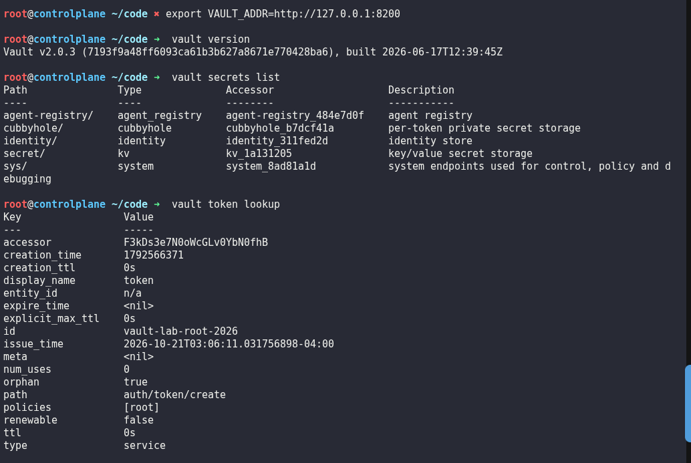
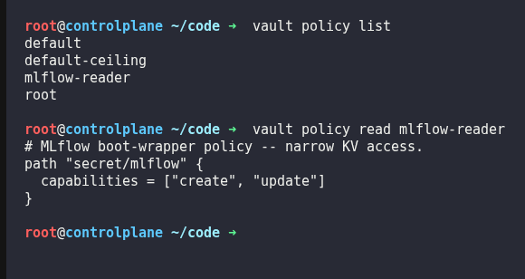
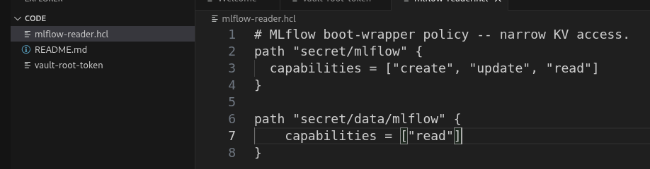
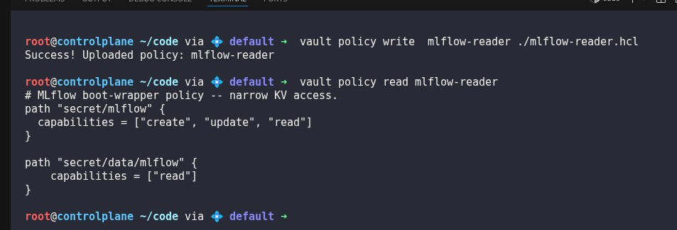
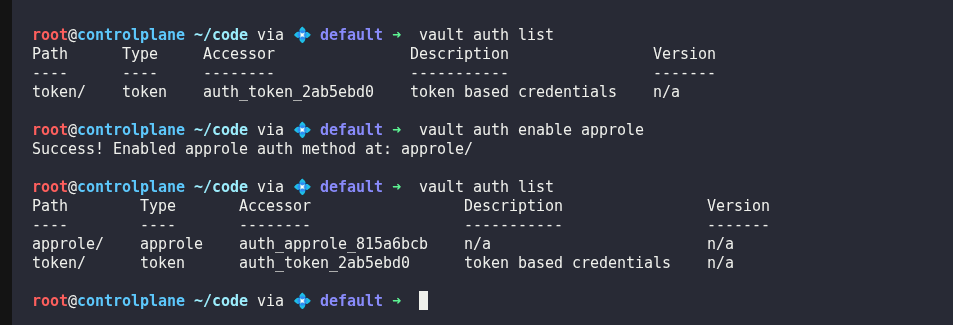
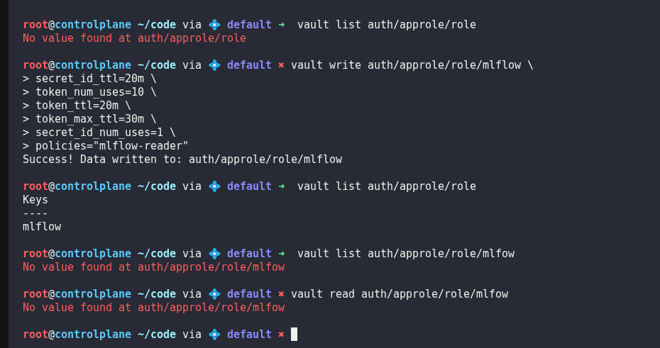
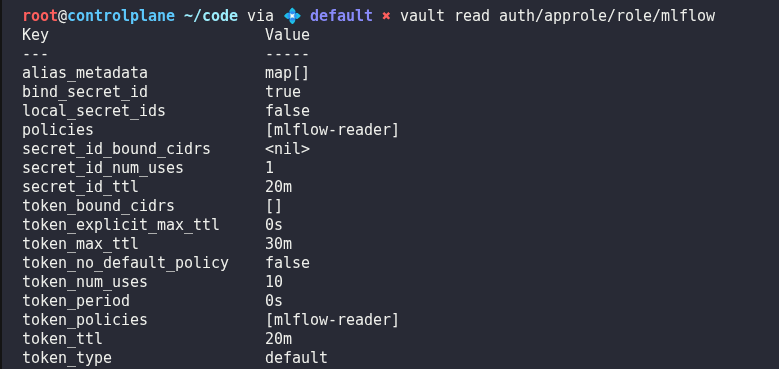
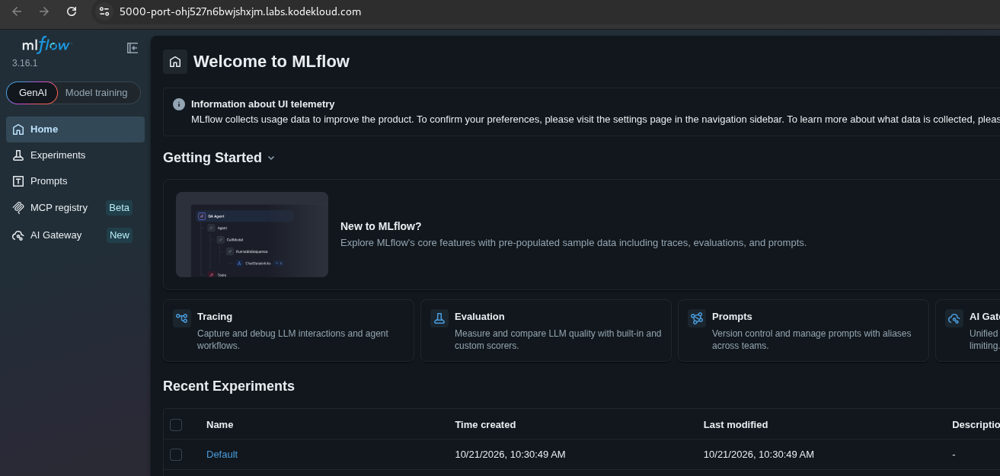

# Day 45: Authenticate MLflow to Vault via AppRole and Fix Its KV Policy

**subject**

***

The xFusionCorp Industries ML platform team has implemented security enhancements before using Vault wiring: the MLflow boot wrapper no longer uses a static token for authentication. Instead, it now utilizes its own**AppRole**credentials to authenticate with Vault and acquires a short-lived token governed by the`mlflow-reader`policy. However, MLflow is currently unable to boot for two primary reasons: the AppRole authentication method is not configured, and the`mlflow-reader`policy contains errors that prevent even valid logins from accessing the secret.

Your task is to correct the`mlflow-reader`policy to ensure it provides`read`access on the KV v2 data path. Subsequently, enable the AppRole authentication method and establish an`mlflow`role that is bound to the adjusted policy. Once you have completed both tasks, the wrapper will log in, successfully read`secret/mlflow`, and MLflow will be operational on port`5000`.

1. The Vault UI is on port`8200`(**Vault**button). The dev-mode**root**token is at`/root/code/vault-root-token`— use it to log in to the UI and for the AppRole CLI steps (both are privileged operations). The`vault`CLI is on`PATH`and reaches the dev server at`VAULT_ADDR=http://127.0.0.1:8200`, authenticating with the root token from that file.
2. The wrapper authenticates via AppRole on its own: once the`mlflow`role exists it fetches the role's`role_id`/`secret_id`, logs in, and reads the secret with the**scoped**token it gets back. Within \~5 s of both fixes being in place it boots MLflow — click the**MLflow UI**button to confirm the tracker is live on port`5000`. There are no credential files to create by hand. While MLflow is still down,`tail /var/log/mlflow-wrapper.log`shows the wrapper looping on what it is waiting for.
3. The end state must include:
   * `GET /v1/sys/policies/acl/mlflow-reader`still returns the policy – Do not rename or delete it.
   * The policy's rules grant`read`on the KV v2 data path`secret/data/mlflow`(a`path "secret/data/mlflow"`block whose capabilities list contains`read`).
   * The AppRole auth method is enabled —`GET /v1/sys/auth`shows`approle/`.
   * An`mlflow`AppRole role exists whose`token_policies`include`mlflow-reader`—`GET /v1/auth/approle/role/mlflow`.
   * `http://localhost:5000/`answers`200`.

> Policies are Vault's**authorisation**layer;**AppRole**is one of its**authentication**methods. A policy's path rules resolve capabilities (`read`,`create`, …) for whatever token makes a call. AppRole is how a*machine*logs in: a role bundles a set of policies, and a service proves its identity with a`role_id`(public, like a username) plus a`secret_id`(private, like a password), receiving a short-lived token scoped by that role's policies — no human and no static root token in the loop. This is the production replacement for the handed-out root token. A KV v2 subtlety also trips people here: secret**data**is served under a`secret/data/<name>`API path, distinct from the logical path you write to with`vault kv put`— a policy rule only grants access to the exact API path it names.

***

https://www.stephane-robert.info/docs/securiser/secrets/hashicorp-vault/authentification/

https://www.stephane-robert.info/docs/securiser/secrets/hashicorp-vault/policies/

\`

basically,  vault command  is vault + type of obj (kv, secrets, policy,...) + verb (list, create, ...)

\`

* Check that vault is properly configured

* Check the existing approle for mlflow

* Fix mlflow-reader policy by adding read capability

* Enable AppRole auth method

* Create mlflow AppRole

* Check that mlflow is accessible

