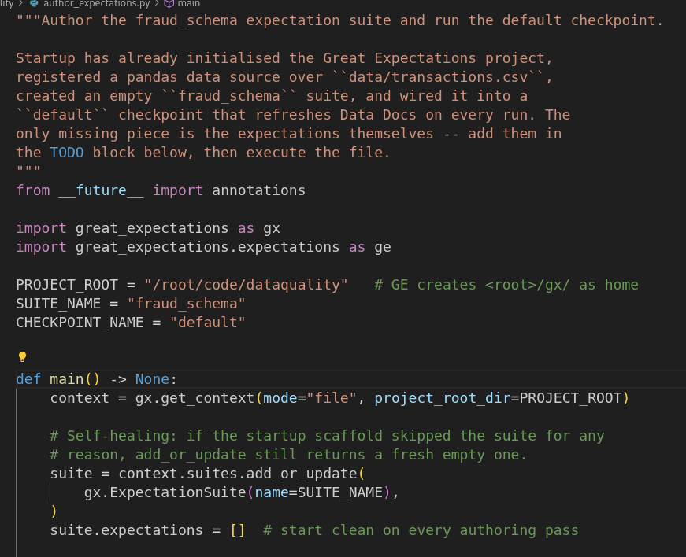
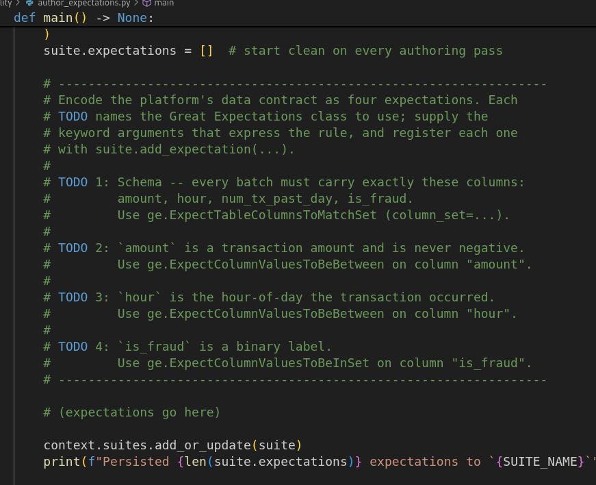
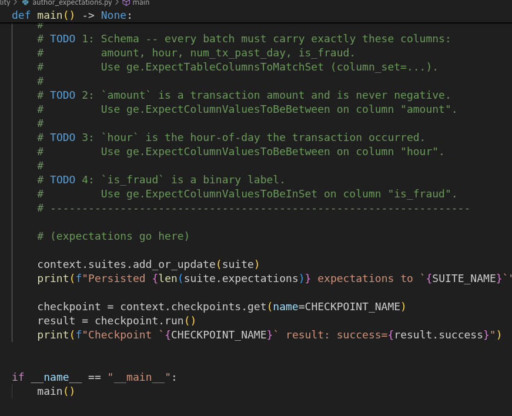
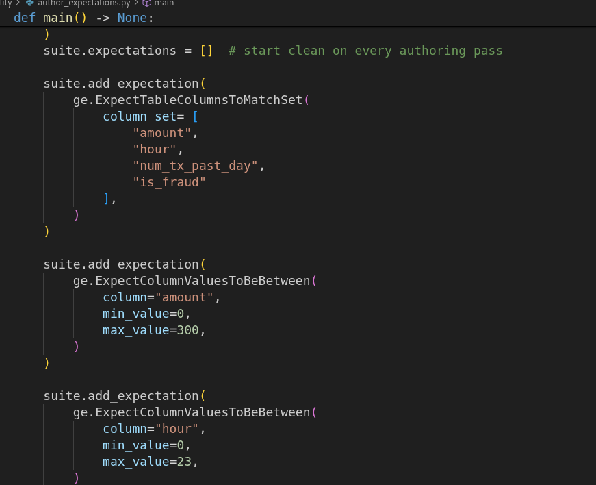
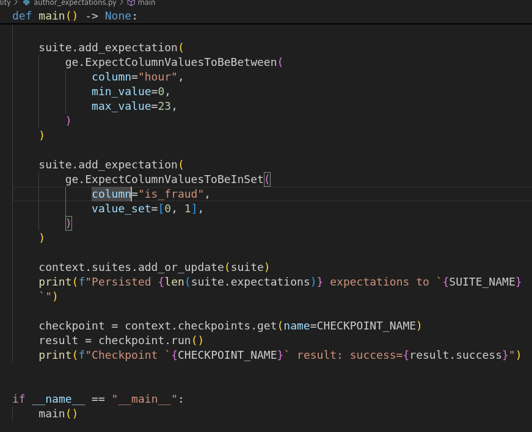
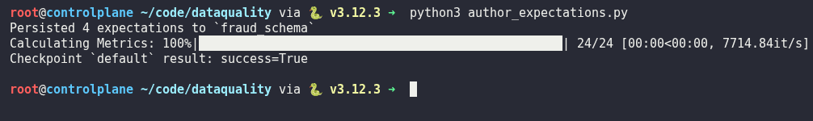
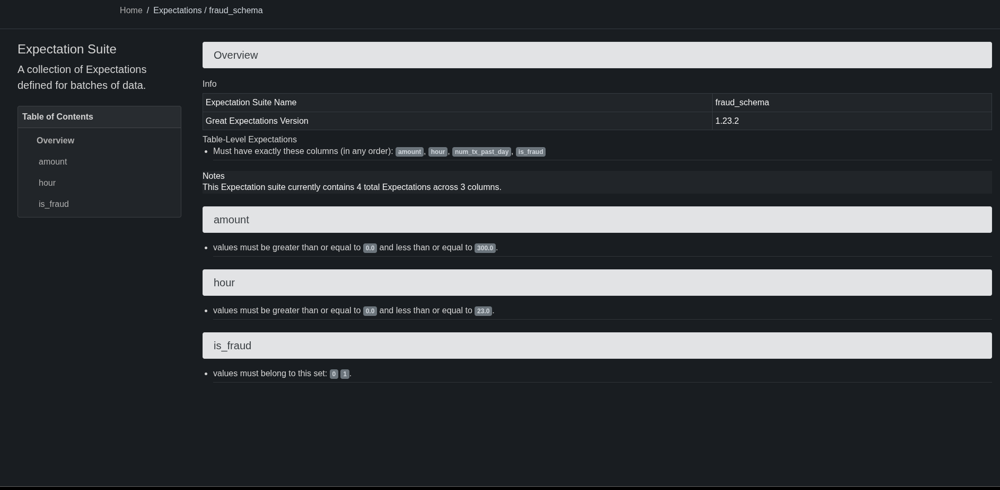
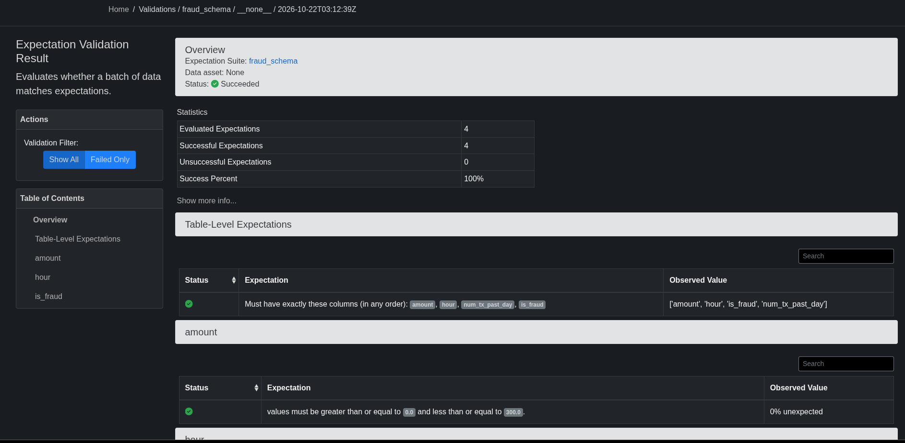

# Day 46: Author Data-Quality Expectations with Great Expectations

**subject**

***

The xFusionCorp Industries ML platform team requires data-schema contracts for every batch that feeds the fraud-detector model. It is essential to identify malformed rows upstream of the training process, rather than three hours later in production. A Great Expectations project has already been initialized at`/root/code/dataquality/gx/`, featuring a pandas data source that reads from`data/transactions.csv`, an empty`fraud_schema`suite, and a`default`checkpoint configured to publish results to Data Docs with each run. Your task is to populate the suite with four expectations and execute the checkpoint to ensure that Data Docs reflects a green status for these expectations.

The platform's**data contract**for a transactions batch is:

* **Schema**— every batch must carry exactly these columns:`amount`,`hour`,`num_tx_past_day`,`is_fraud`.
* **`amount`**— a transaction amount; it is never negative.
* **`hour`**— the hour-of-day the transaction occurred.
* **`is_fraud`**— a binary label.

`/root/code/dataquality/author_expectations.py`carries four numbered TODOs, each naming the Great Expectations class that encodes one contract rule (imports for`great_expectations as gx`and`great_expectations.expectations as ge`are already in place):

* **TODO 1:**`ExpectTableColumnsToMatchSet`— the required column set.
* **TODO 2:**`ExpectColumnValuesToBeBetween`on`amount`.
* **TODO 3:**`ExpectColumnValuesToBeBetween`on`hour`.
* **TODO 4:**`ExpectColumnValuesToBeInSet`on`is_fraud`.

Running the script persists the suite to disk (`gx/expectations/fraud_schema.json`) and executes the`default`checkpoint, which validates`transactions.csv`against the suite and refreshes the Data Docs site. Data Docs is available from the**Data Docs**button at the top of the lab (port`8081`), where each`fraud_schema`run renders with a green or red pill per expectation.

The end state must include:

* `gx/expectations/fraud_schema.json`has all four expectations by type (`expect_table_columns_to_match_set`, two`expect_column_values_to_be_between`entries – One per column — and`expect_column_values_to_be_in_set`).
* Each expectation's kwargs encode the data contract above.
* The most recent validation JSON under`gx/uncommitted/validations/`has`success: true`.
* The Data Docs index page served on`:8081`references`fraud_schema`.

> Great Expectations treats data quality as code—expectation suites are versioned artefacts in the same repo as the model that consumes the data, run by the same CI that runs pytest. A run's result JSON is machine-readable (a downstream CI-gate lab consumes it), and Data Docs is the human-readable rendering of the same content. This task lays the ground for both.

***

* Check the existing code base

* add Expectation

* Run and check

