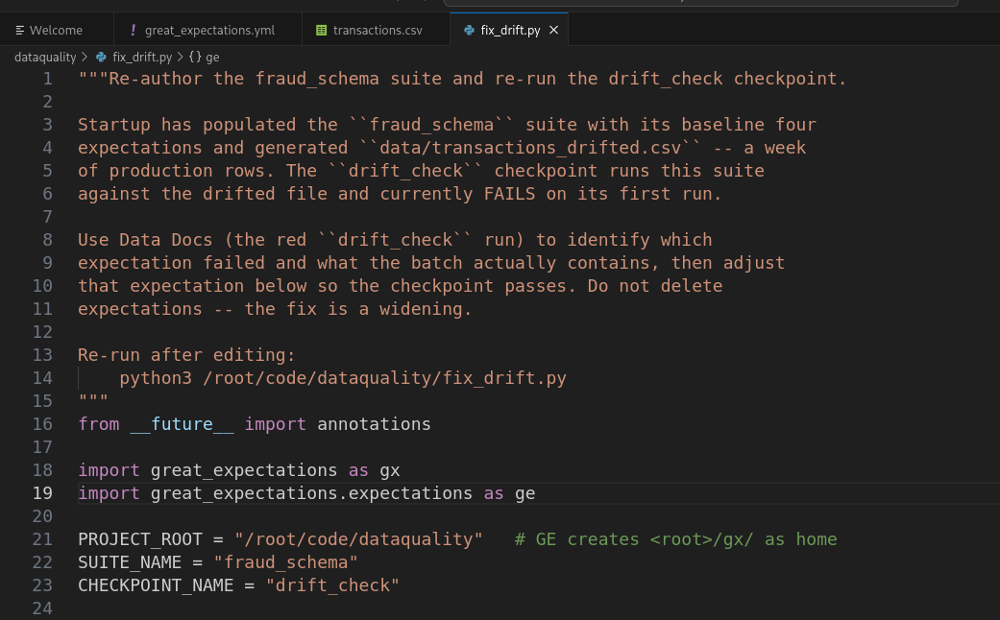
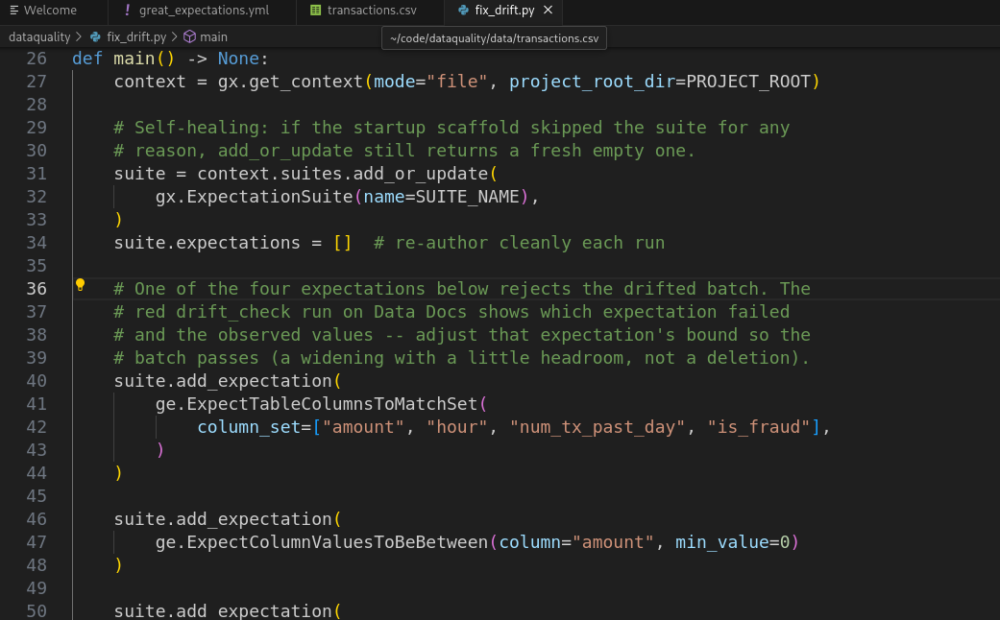
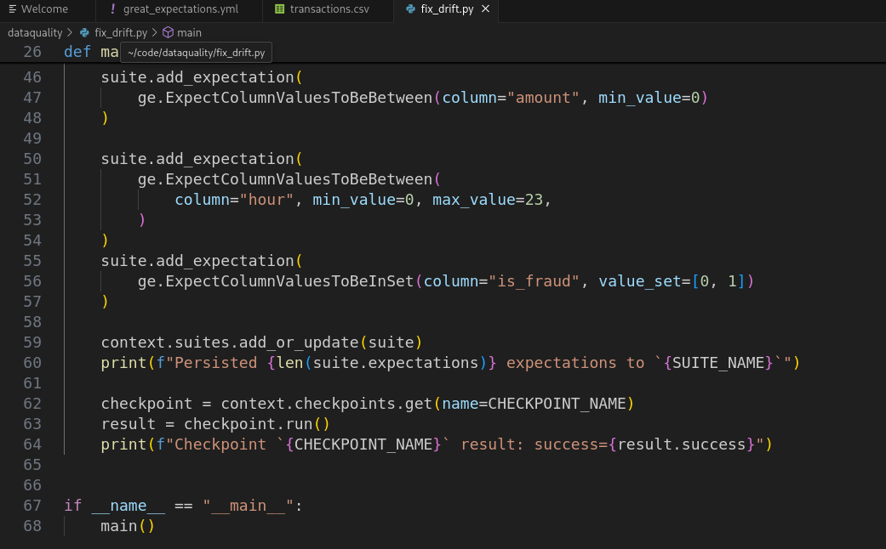
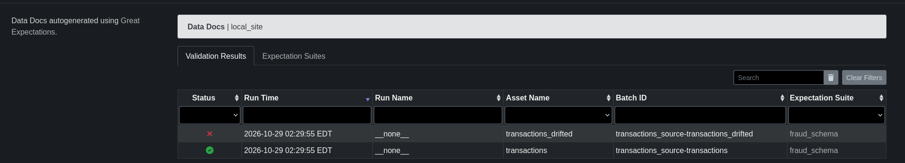
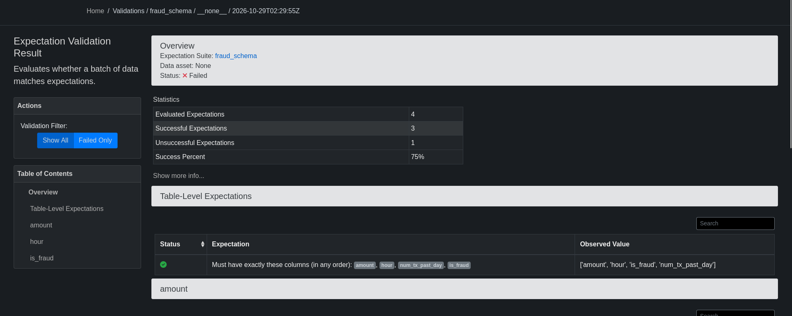
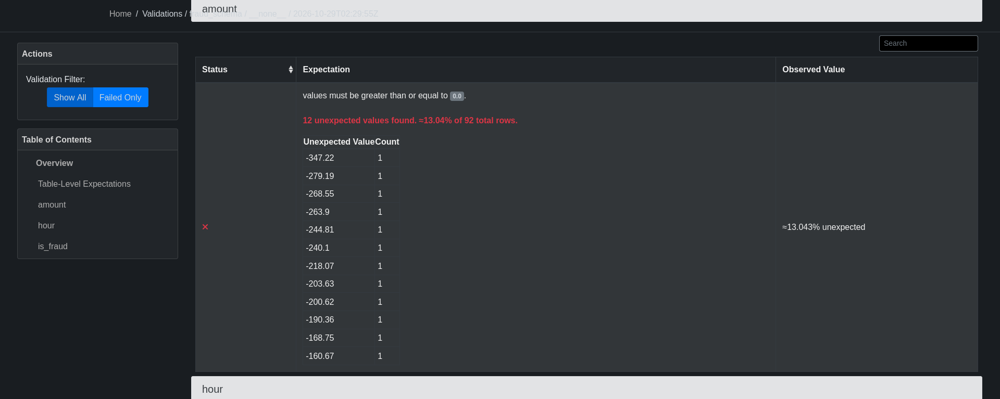
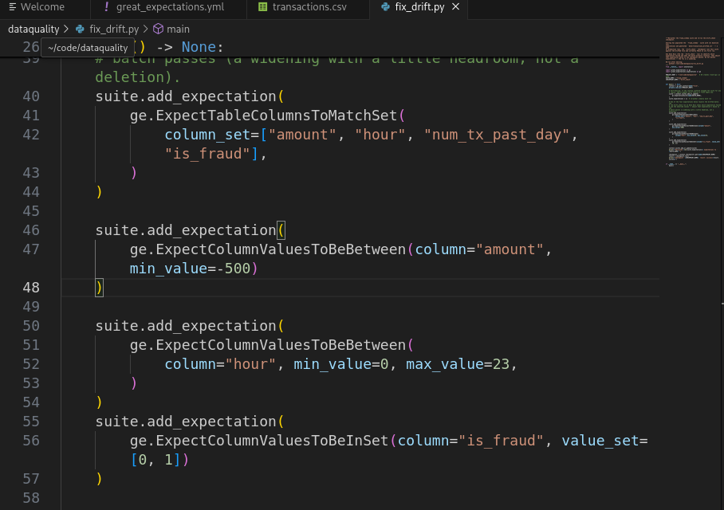
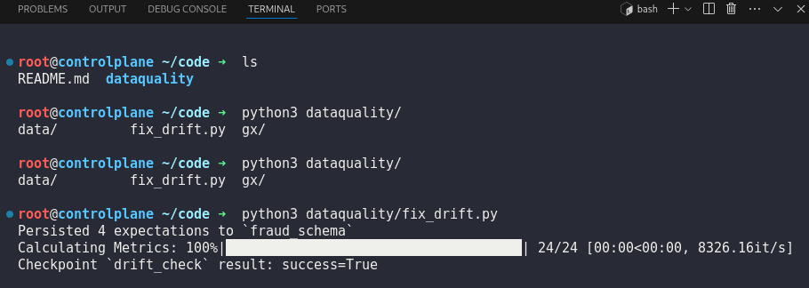
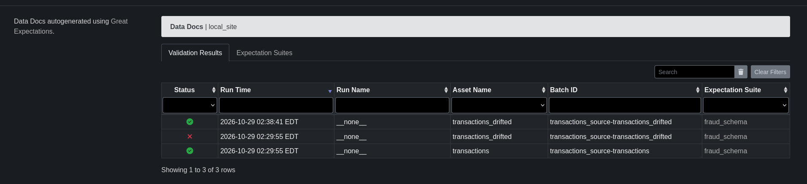

# Day 47: Debug a Failing Great Expectations Checkpoint

**Subject**

***

The xFusionCorp Industries ML platform team has extended the `fraud_schema` suite to include a second batch—`data/transactions_drifted.csv`, which consists of a week's worth of real production data. The `drift_check` checkpoint executes the existing suite against this file and fails on its initial run. Your objective is to utilize Data Docs to identify which expectation failed and the reason for the failure, modify the offending bound in the fix-script, re-run the checkpoint, and verify that Data Docs reflects a successful outcome.

Data Docs is available from the **Data Docs** button (port `8081`). The landing page lists two past validation runs under `fraud_schema`:

* **`default`** – green (against the clean `transactions.csv`).
* **`drift_check`** – **red** (against the drifted file).

To see the failure, re-run the checkpoint and read its output:

```
python3 /root/code/dataquality/fix_drift.py
```

The red `drift_check` run on Data Docs is the debug surface: it names the failing expectation and shows the observed batch values.

`/root/code/dataquality/fix_drift.py` already contains all four expectations. Adjusting the offending expectation so it admits the observed values—rather than deleting any expectation—and re-running the script re-persists the suite and re-executes the `drift_check` checkpoint, turning the most recent `drift_check` run green.

The end state must include:

* The `drift_check` checkpoint is still present in `gx/checkpoints/`.
* `gx/expectations/fraud_schema.json` still has all four core expectation types (the fix is a widening, not a deletion).
* The most recent validation JSON under `gx/uncommitted/validations/` for checkpoint `drift_check` reports `success: true`.

> The failing-validation page is the core debug surface for data-quality incidents: it tells you WHICH expectation failed, WHAT was observed, and by how much. A real team uses that same signal to decide whether the data genuinely drifted (update the rule) or whether the data is broken (fix upstream). Either way, the read-the-evidence step comes first.

***

* Check the existing code base







* Check the error in data docs







The error is that for the amount column there are negative value

* Fix the negative value error to be admitted



* Rerun the fix\_drift.py to see where the error actually is




