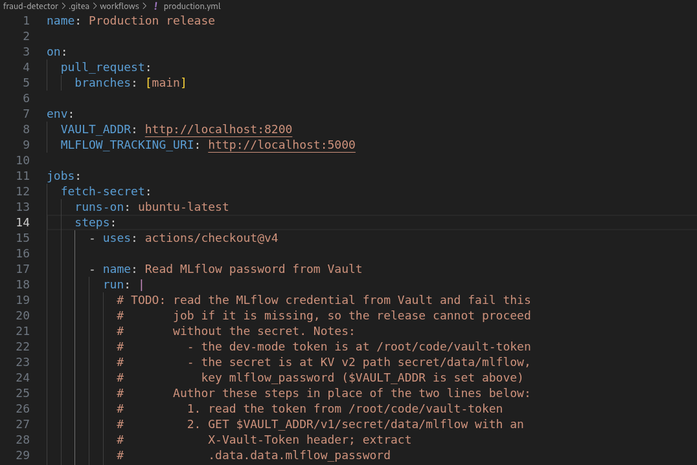
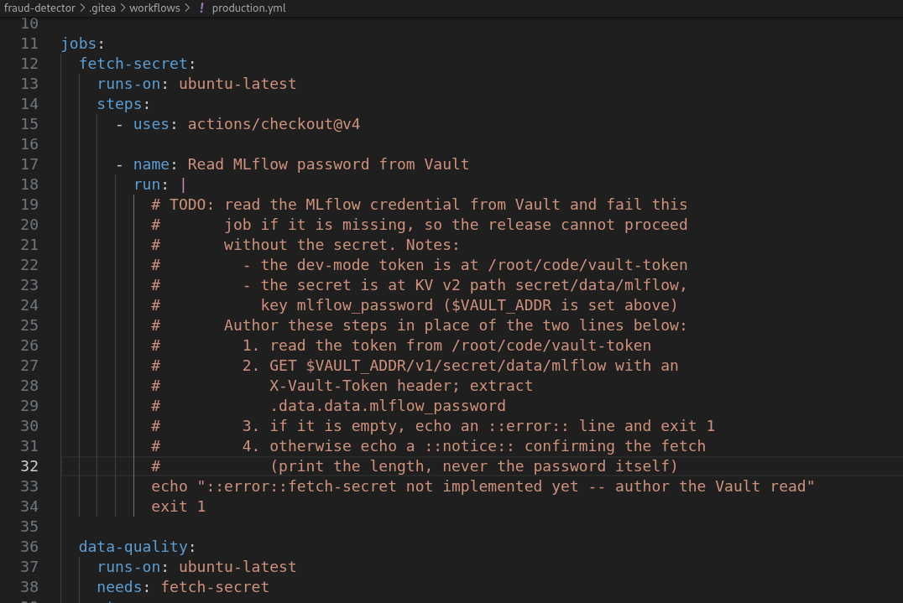
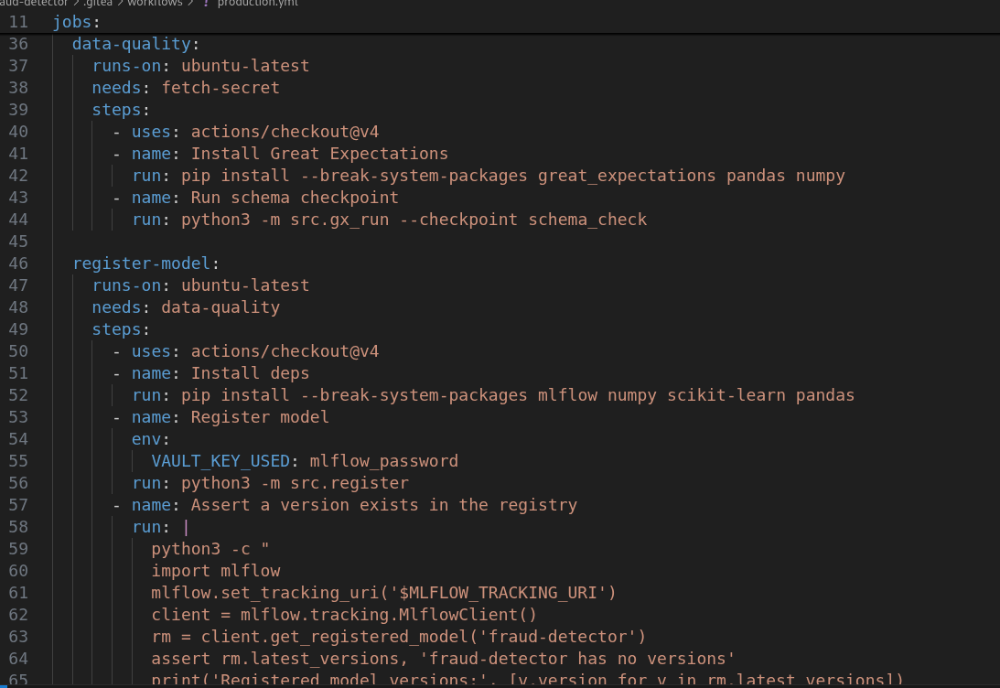
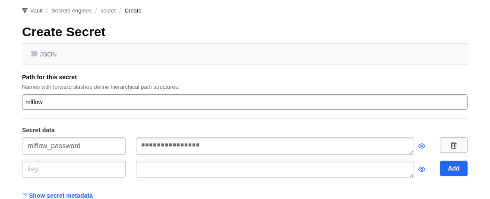
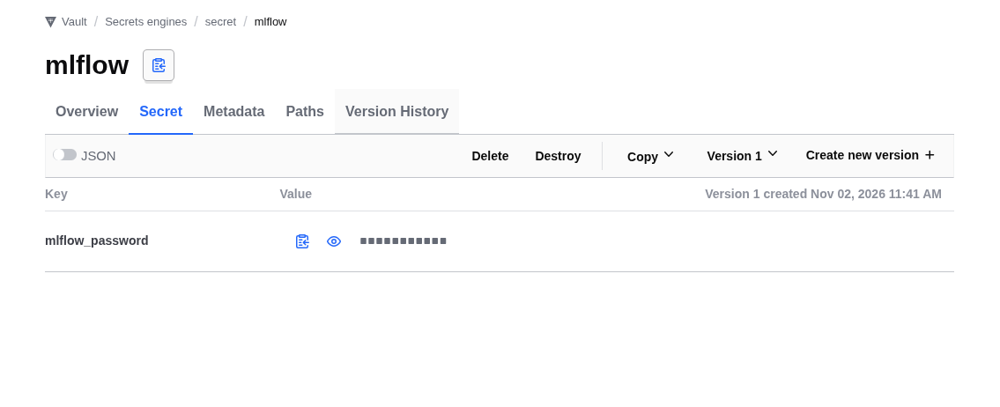
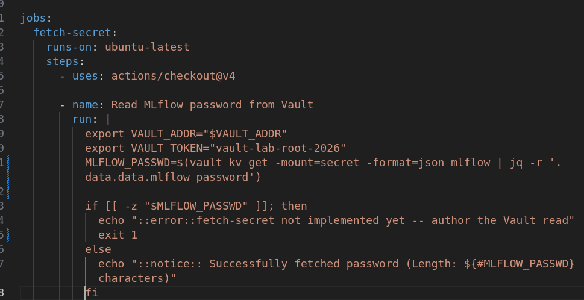
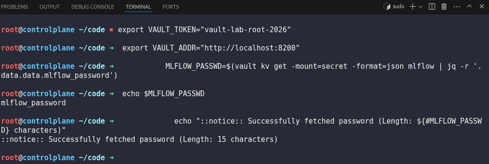
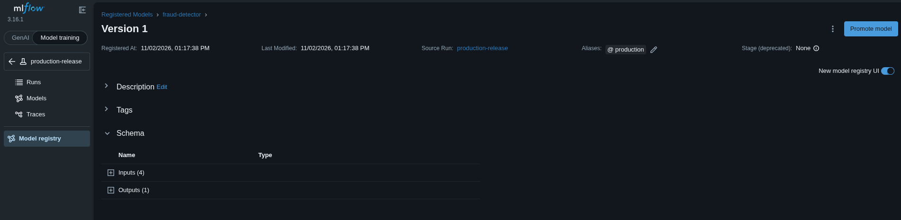
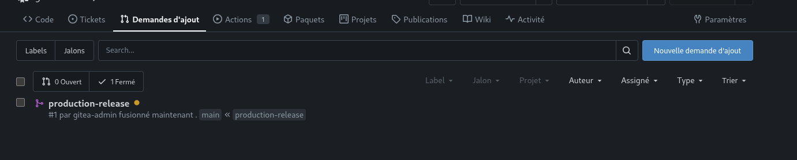
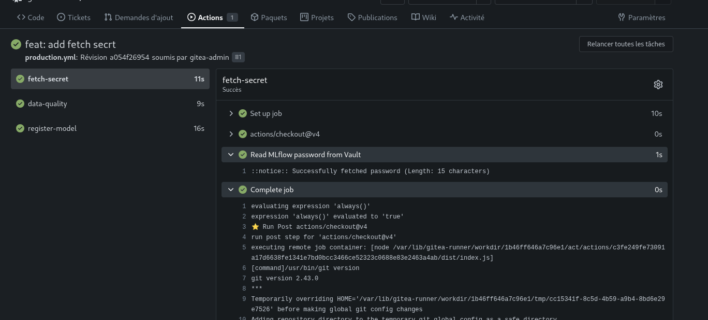

# Day 49: Secrets + Data-Quality Integration Capstone

**subject**

***

The xFusionCorp Industries ML platform team is preparing to cut their first end-to-end release of the`fraud-detector`repository. This release comprises a three-job Gitea Actions workflow that includes: pulling the MLflow credential from Vault, verifying data quality by gating on a Great Expectations checkpoint, and registering the trained model in MLflow. All four services—Vault, MLflow, Gitea, and the Actions runner—are operational. However, the first job of the workflow remains incomplete, as the step for reading from Vault is noted as a TODO. Your final task is to complete this section by scripting the step to pull the MLflow credential from Vault, and subsequently, execute the release across its various user interfaces: staging the credential in Vault, initiating and merging a pull request in Gitea, and promoting the registered model in MLflow.

Each of the four UIs has a button at the top of the lab:

* **Gitea**(port`3000`) –`gitea-admin`/`gitea2026`. The`fraud-detector`repo sits on`main`; a feature branch`production-release`is pre-pushed. No pull request has been opened yet.
* **Vault**(port`8200`) – log in with the token at`/root/code/vault-token`. The KV v2 engine is enabled at`secret/`;`secret/mlflow`is empty.
* **MLflow UI**(port`5000`) – the**Models**page is empty.
* **Data Docs**– rendered by the`data-quality`job once the workflow runs.

The workflow at`.gitea/workflows/production.yml`on the`production-release`branch has three jobs (`fetch-secret`→`data-quality`→`register-model`). The`data-quality`and`register-model`jobs are complete; the`fetch-secret`job's Vault-read step is left as a`# TODO`in the working clone at`/root/code/fraud-detector`. The workflow reads a Vault KV key, runs the`schema_check`GE checkpoint, and registers the trained model as`fraud-detector`in MLflow; it only triggers on`pull_request`against`main`.

The end state must include:

* `secret/mlflow`has a non-empty`mlflow_password`key (any value works).
* The`fetch-secret`job on the`production-release`branch reads the KV v2 path`secret/data/mlflow`and its`mlflow_password`key (the authored step).
* A pull request exists from`production-release`→`main`and has been merged.
* The workflow run on that PR's head commit reaches combined status`success`(all three jobs green).
* `fraud-detector`is registered in MLflow with the`production`alias pointing at one of its versions.

> Each of the four pieces lives behind a different UI and, in a real team, a different owner: Vault (security), Gitea (the dev lead opening + merging the PR), MLflow (the ML engineer promoting the model), Data Docs (the data team reviewing the quality report). The capstone walks all four. Order matters for the first step: stage the Vault secret before opening the PR, otherwise the workflow's very first job fails and the reader has to re-trigger.

***

* Check the existing workflow

* Create a mflow\_password

* Write the task to get secret from the vault

* Test it locally first

* Add alias for the model in mlflow

* Push and check

