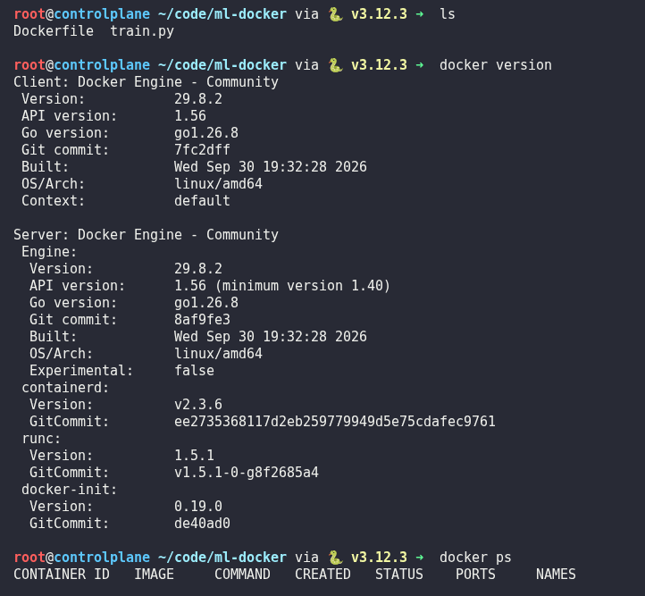
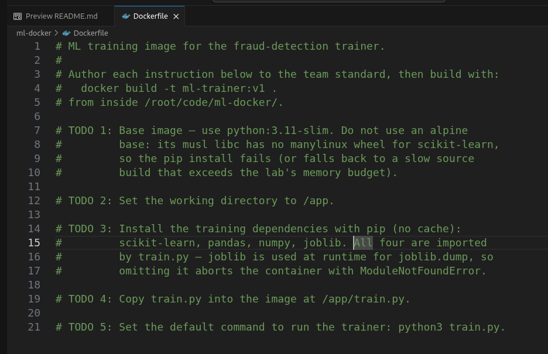
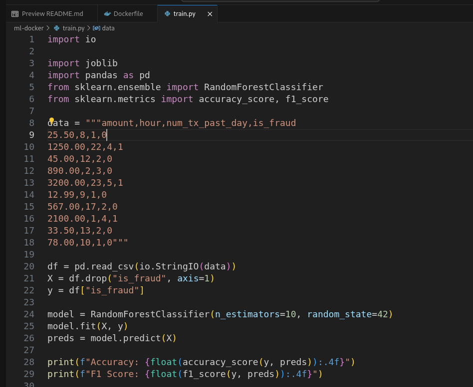
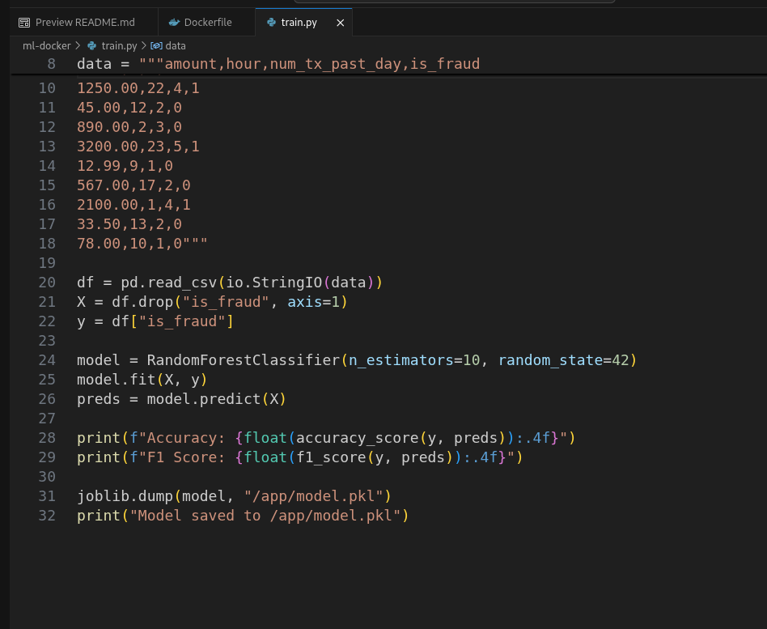
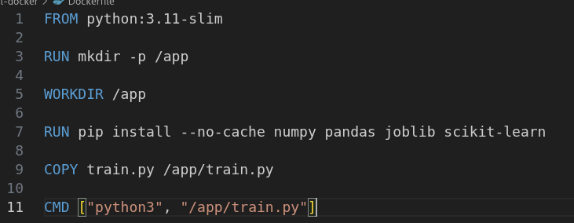
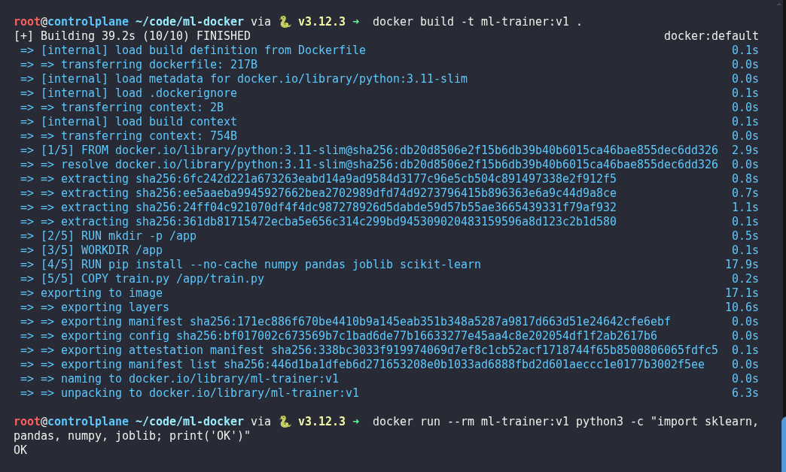
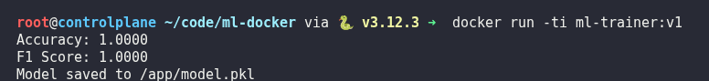

# Day 50:  Create Docker Image for ML Training Environment

**subject**

***

The xFusionCorp Industries ML platform team has created a Docker image for the fraud-detection training environment, allowing every engineer to achieve consistent results by executing the command`docker run ml-trainer:v1`. A scaffold for the`Dockerfile`is located at`/root/code/ml-docker/`, with its construction outlined as numbered TODOs. Your objective is to complete the Dockerfile in accordance with the team's standards, ensuring that the command`docker build -t ml-trainer:v1 .`executes successfully and that every Python import required by the training code is correctly resolved within the image.

1. The Docker daemon is already running.`docker version`can be run in a VS Code terminal to confirm.
2. The project layout under`/root/code/ml-docker/`:
   * `train.py`– 10-row synthetic fraud-detection training stub; fits a RandomForest, prints accuracy + F1, and persists the model to`/app/model.pkl`with`joblib.dump(...)`. Correct and must remain intact.
   * `Dockerfile`– The image definition, scaffolded as five numbered TODOs (base image, working directory, dependency install, copy, command). Author each to the team standard.
3. The end state must include:
   * The base image is`python:3.11-slim`.
   * `WORKDIR /app`is set.
   * The`pip install`line installs every package the training code imports (`scikit-learn`,`pandas`,`numpy`,`joblib`).
   * `docker images ml-trainer:v1`lists the built image.
   * `docker run --rm ml-trainer:v1 python3 -c "import sklearn, pandas, numpy, joblib; print('OK')"`prints`OK`.

> `docker build .`can be run repeatedly as each instruction lands; Docker re-uses cached layers so only the changed line re-runs.`train.py`is complete and must stay intact — only the`Dockerfile`is authored.

***

* Check docker is installed

* Check the existing work (Dockerfile, python code)

* Writting the Dockerfile

* Check the result

